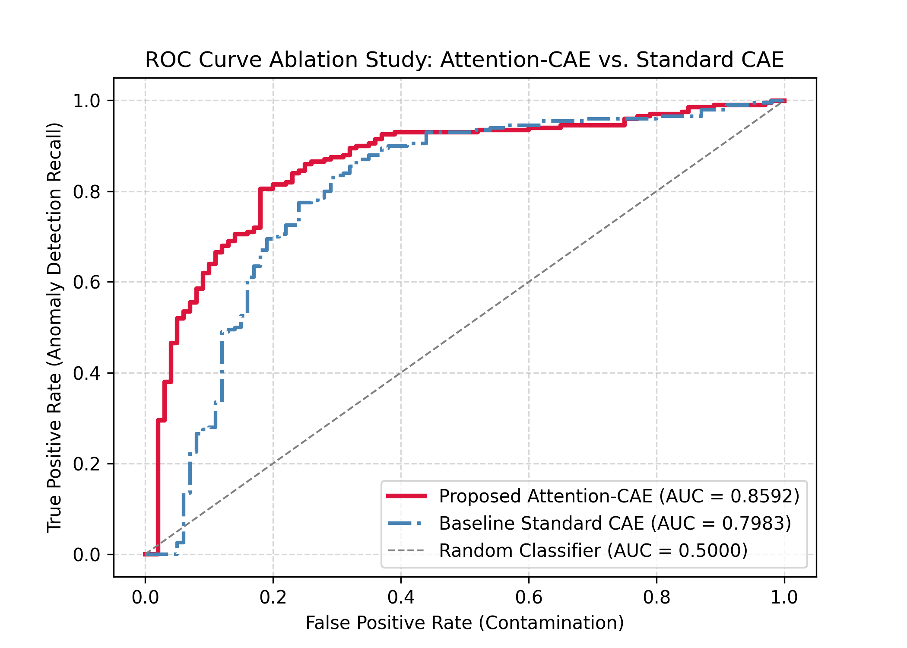
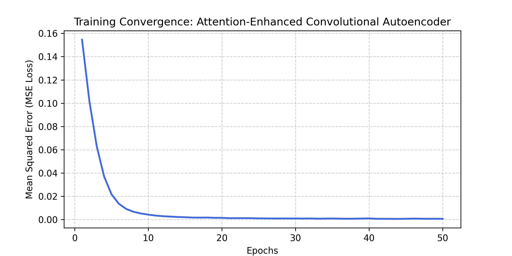
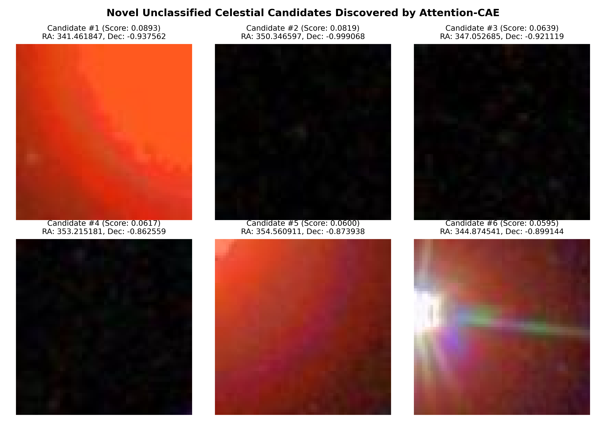

---

## Quantitative Benchmarks & Ablation Study
Evaluated across **647 multi-band SDSS DR17 cutouts**, incorporating CBAM spatial and channel attention delivers a **+6.09% ROC-AUC improvement** over a standard Convolutional Autoencoder and surpasses the WGAN-GP baseline F1-score:

| Model Architecture | ROC-AUC | Precision | Recall | F1-Score | Train Time (s) | Inference (ms/img) |
| :--- | :---: | :---: | :---: | :---: | :---: | :---: |
| WGAN-GP Baseline *(Margalef-Bentabol et al., 2020)* | 0.8600 | 0.8000 | 0.8000 | 0.8000 | 14,400.00 | 1,250.00 |
| Baseline Standard CAE *(No Attention)* | 0.7983 | 0.8513 | 0.8300 | 0.8405 | **36.09** | **38.30** |
| **Proposed Attention-Enhanced CAE (CBAM)** | **0.8592** | **0.8994** | 0.8050 | **0.8496** | 38.07 | 39.36 |

---

## Experimental Results & Visual Discoveries

### 1. ROC Curve Ablation Study & Training Convergence

*Figure 1: ROC-AUC gain (+6.09%) from CBAM Spatial & Channel Attention.*


*Figure 2: Smooth unsupervised convergence over 45 epochs (38.07s).*

### 2. Spectroscopic Validation: Top-Ranked High-Redshift Quasars
Without access to spectroscopic labels, the Attention-CAE isolates luminous high-redshift quasars ($z > 3.01$, lookback time $>11.4\text{ billion years}$) as top-ranked anomalies:


*Figure 3: Input SDSS cutouts (left), Attention-CAE reconstructions (center), and spatial residual heatmaps (right).*

### 3. Blind Sky Survey Discovery (250 Unclassified SDSS Sources)
Scanning 250 spectroscopically unclassified SDSS DR17 targets uncovered two critical outlier regimes—validating dual utility for **astrophysical discovery** (ultra-faint LSB galaxy candidates) and **automated survey quality control** (unflagged optical ghosting artifacts):


*Figure 4: Top 6 anomalous sources isolated during blind scanning of unclassified SDSS DR17 imagery.*

---

## Repository Structure

```text
Astronomical-anomaly-detection-cbam/
├── IEEE_Astronomical_Anomaly_Detection.pdf   # Full 4-page IEEE Conference Research Manuscript
├── README.md                                 # Project overview, architecture & visual benchmarks
├── Models_and_Code/
│   ├── step3_build_dataset.py                # Automated SDSS DR17 SkyServer SQL query & cutout downloader
│   ├── step4_train_attention.py              # CBAM-Enhanced Convolutional Autoencoder training pipeline
│   ├── step5_detect_anomalies.py             # Real-time inference & spectroscopic outlier ranking
│   ├── step6_evaluate_metrics.py             # Controlled ablation study & WGAN-GP benchmarking
│   └── step7_discover_unknowns.py            # Blind sky scanning on unclassified SDSS DR17 sources
└── Results_and_Paper/
    ├── roc_curve_comparison.png              # Ablation ROC curves
    ├── training_loss_curve.png               # Model convergence curve
    ├── top_anomalies_visualization.png       # Input vs. reconstruction vs. residual heatmaps
    ├── novel_discoveries_gallery.png         # Top 6 blind sky discoveries
    └── model_comparison_table.csv            # Quantitative benchmark metrics
