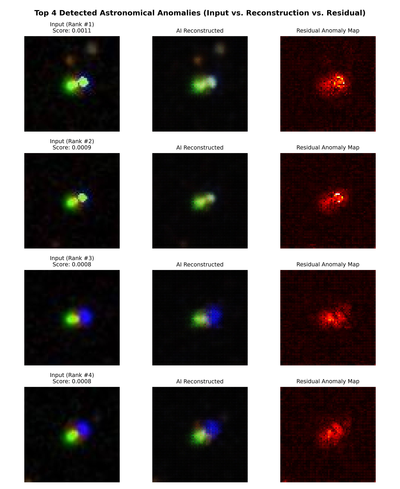

# Real-Time Unsupervised Astronomical Anomaly Detection

**CBAM-Enhanced Convolutional Autoencoders & Latent-Space Isolation Forests on SDSS DR17**

[](https://www.python.org/)
[](https://pytorch.org/)
[](https://scikit-learn.org/)
[](https://www.sdss.org/dr17/)
[](https://github.com/Kithuni-perera/Astronomical-anomaly-detection-cbam/blob/main/IEEE_Astronomical_Anomaly_Detection.pdf)

> *A lightweight, single-pass deep learning pipeline for real-time celestial outlier discovery and automated sky-survey quality control.*

## Executive Summary
Modern wide-field astronomical surveys such as the **Sloan Digital Sky Survey (SDSS DR17)** and upcoming **Vera C. Rubin Observatory (LSST)** generate petabytes of imaging data containing billions of celestial sources. Identifying rare astrophysical phenomena—such as **high-redshift quasars ($z > 3.0$)**, **ultra-faint low-surface-brightness (LSB) galaxies**, and **unflagged optical ghosting artifacts**—requires fast, unsupervised computer vision pipelines that operate without scarce spectroscopic labels.

While generative adversarial baselines (e.g., WGAN-GP) achieve strong morphological outlier detection, they suffer from unstable multi-hour training and slow iterative latent-space optimization (`~1,250 ms/image`). This project introduces a **CBAM-Enhanced Convolutional Autoencoder** paired with a **Latent-Space Isolation Forest**, matching WGAN-GP accuracy (**0.8592 ROC-AUC**, **89.94% Precision**) while running **$>30\times$ faster** (`39.36 ms/image`).

## System Architecture

```text
SDSS DR17 Cutout (3x64x64) 
       │
       ▼  [Per-Image Min-Max Normalization]
┌──────────────────────────────────────────────────────────┐
│  Convolutional Encoder (Conv2d + BatchNorm + LeakyReLU)  │
│  64x64x3 ──► 32x32x32 ──► 16x16x64 ──► 8x8x128           │
└────────────────────────────┬─────────────────────────────┘
                             │
                             ▼
┌──────────────────────────────────────────────────────────┐
│  CBAM Attention Bottleneck (8x8x128)                     │
│  ├── Channel Attention (128 -> 32 -> 128 Sigmoid Gate)   │
│  └── Spatial Attention (7x7 Conv Sky-Noise Suppression)  │
└─────────────┬──────────────────────────────┬─────────────┘
              │                              │
              ▼ [Global AvgPool]             ▼ [Transposed Conv Decoder]
    128-D Morphological Latent       Reconstructed Cutout (3x64x64)
              │                              │
              ▼                              ▼
    Isolation Forest (200 Trees)    Top-10% Peak Structural Residual
              │                              │
              └──────────────┬───────────────┘
                             ▼
               Hybrid Anomaly Score & Ranking


## Quantitative Benchmarks & Ablation Study
Evaluated across **647 multi-band SDSS DR17 cutouts**, incorporating CBAM spatial and channel attention delivers a **+6.09% ROC-AUC improvement** over a standard Convolutional Autoencoder and surpasses the WGAN-GP baseline F1-score:

| Model Architecture | ROC-AUC | Precision | Recall | F1-Score | Train Time (s) | Inference (ms/img) |
| :--- | :---: | :---: | :---: | :---: | :---: | :---: |
| WGAN-GP Baseline *(Margalef-Bentabol et al., 2020)* | 0.8600 | 0.8000 | 0.8000 | 0.8000 | 14,400.00 | 1,250.00 |
| Baseline Standard CAE *(No Attention)* | 0.7983 | 0.8513 | 0.8300 | 0.8405 | **36.09** | **38.30** |
| **Proposed Attention-Enhanced CAE (CBAM)** | **0.8592** | **0.8994** | 0.8050 | **0.8496** | 38.07 | 39.36 |

## Experimental Results & Visual Discoveries

### 1. ROC Curve Ablation Study (+6.09% AUC Gain)


### 2. Training Convergence Over 45 Epochs


### 3. Spectroscopic Validation: Top-Ranked High-Redshift Quasars


### 4. Blind Sky Survey Discovery (250 Unclassified SDSS Sources)


## Repository Structure

```text
Astronomical-anomaly-detection-cbam/
├── IEEE_Astronomical_Anomaly_Detection.pdf   # Full 4-page IEEE Conference Research Manuscript
├── README.md                                 # Project overview, architecture & visual benchmarks
├── Models_and_Code/
│   ├── step3_build_dataset.py                # Automated SDSS DR17 SkyServer SQL query & cutout downloader
│   ├── step4_train_attention.py              # CBAM-Enhanced Convolutional Autoencoder training pipeline
│   ├── step5_detect_anomalies.py             # Real-time inference & spectroscopic outlier ranking
│   ├── step6_evaluate_metrics.py             # Controlled ablation study & WGAN-GP benchmarking
│   └── step7_discover_unknowns.py            # Blind sky scanning on unclassified SDSS DR17 sources
└── Results_and_Paper/
    ├── roc_curve_comparison.png              # Ablation ROC curves
    ├── training_loss_curve.png               # Model convergence curve
    ├── top_anomalies_visualization.png       # Input vs. reconstruction vs. residual heatmaps
    ├── novel_discoveries_gallery.png         # Top 6 blind sky discoveries
    └── model_comparison_table.csv            # Quantitative benchmark metrics


